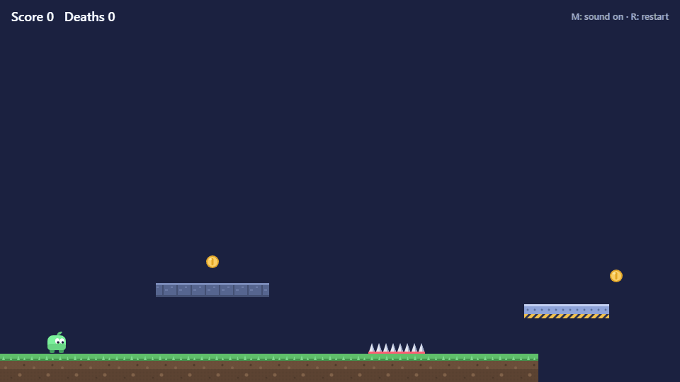
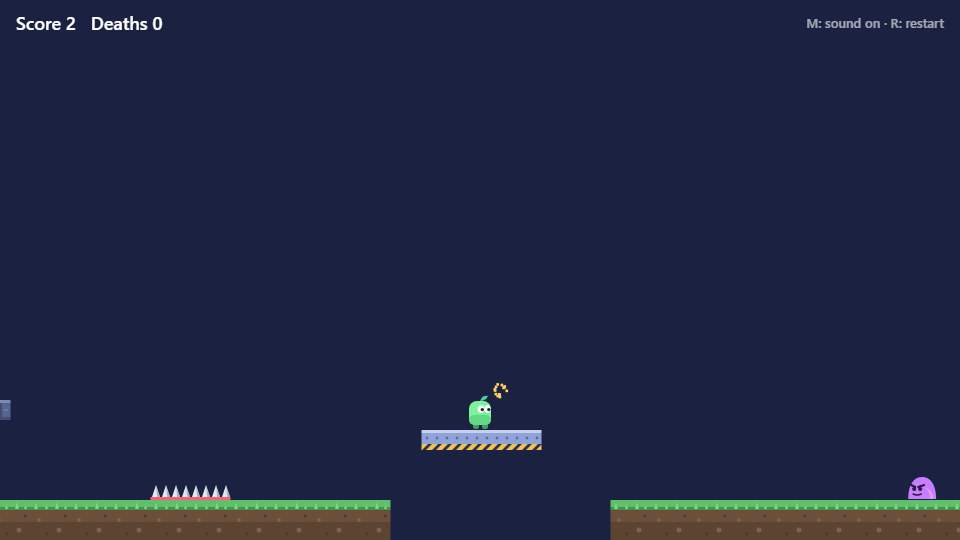
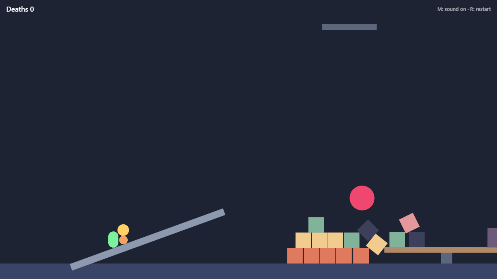
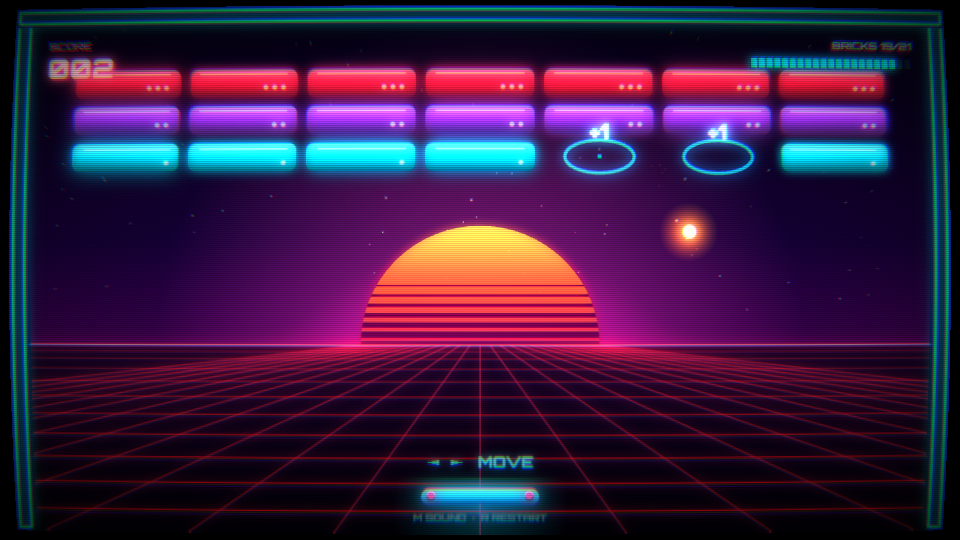
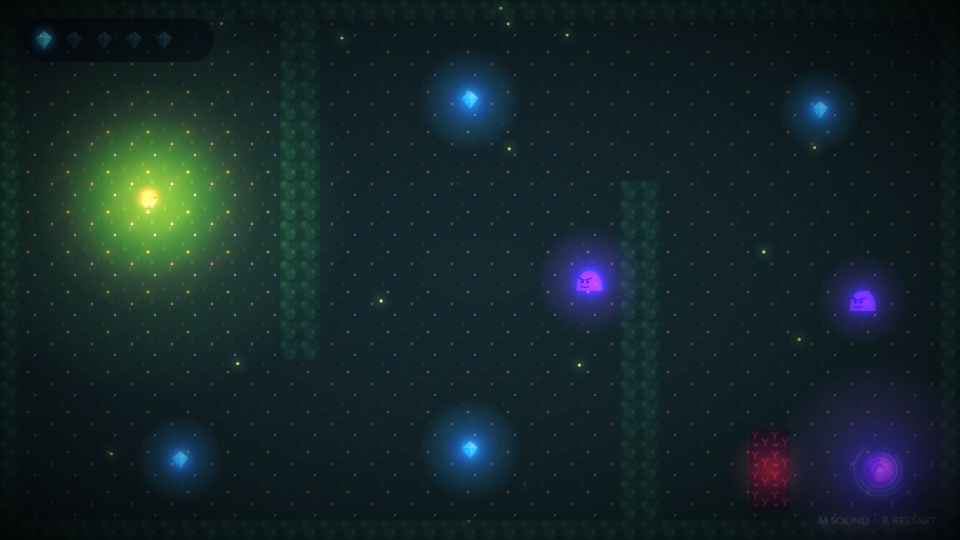
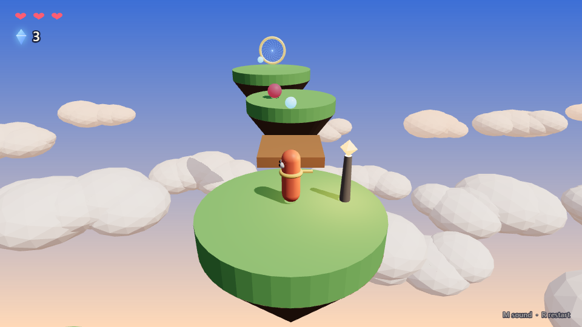

# Ludra

[](https://github.com/ersingvn/ludra/actions/workflows/ci.yml)
[](https://www.npmjs.com/package/@ludra/cli)
[](LICENSE)

**The game engine built for AI agents.**

<p align="center">
  
  <br>
  <sub>The <code>platformer</code> template, replayed from its own test script: <code>won == true</code>, <code>deaths == 0</code>.</sub>
</p>

Unity, Unreal and Godot are designed for humans clicking around an editor. Ludra is designed for an agent like Claude: games are plain JSON, every problem comes with a machine-readable fix, and the agent can **play its own game headlessly** to prove it works before a human ever touches it.

You describe the game. The agent builds it with Ludra, checks it, plays it, tests it and hands it to you.

```
you    > make me a platformer with spikes, a moving platform over a pit and an enemy to stomp
claude > ludra new slime-valley
         ludra check     ✓ 15 entities, no problems
         ludra play --inputs "right:0.3s, right+jump:0.45s, ..." --watch player,lift,slime
         ludra test      ✓ 6 passed, 0 failed (won == true, deaths == 0)
         Done. Run `ludra dev` to play it.
```

> **Status:** early (v0.93). 3D games with Three.js and Rapier 3D, including any glTF model with skeletal animation on the simulation clock and colliders of any shape (from a model, or procedural terrain), and 2D games in several genres (platformers, top-down adventures, breakout, physics games) on arcade or real Rapier physics, with tilemaps, camera zones, tweens, multiple levels, lives, checkpoints and prefabs, `ludra review` to catch unfinished and unfair work, `ludra solve` to prove a level can be won and how tight each jump is, `ludra fuzz` to find crashes and softlocks by random play, art drawn in code with lighting, custom interfaces and GLSL post-processing, a library of ready-made gameplay blocks, custom TypeScript scripts, enemies, hazards, moving platforms, goals, animated SVG sprites, particles, each game's own synthesized sounds and music, plus the full agent toolchain including real rendered screenshots and `ludra inspect` to read any model, image or sound as text, work today. Sharper eyes and taste (contact sheets, visual diffs, design intent) are next on the [roadmap](#roadmap).

## The idea

Unity-level games, made by AI, that are actually good. Ludra rests on two promises:

- **No ceiling on creativity.** The agent gets raw power, not a menu of presets: the full Canvas 2D API, GLSL shaders, any font, TypeScript for any mechanic, any genre. The engine never says "that's all you can do".
- **No slop.** Power alone produces games that look generated: generic, untested, silent, flat. So Ludra gives the agent eyes (simulation, screenshots), proof (deterministic tests), taste (a design guide) and a reviewer that flags unfinished work. The few hard rules guard correctness, never creativity: the simulation is deterministic, drawing can't change the game, and a game isn't done until `check`, `test` and `review` are clean.

What that means for every feature:

1. **Raw power, thin layer.** Three.js, Rapier, Web Audio, GLSL and Canvas are fully open to scripts. Ludra adds what an agent can't build alone (the loop below) and stays out of the way of everything else.
2. **Starting points are source, not boxes.** Templates, blocks and examples are copied into the project as files the agent reads and rewrites. Nothing ships as a preset the agent can only configure.
3. **Eyes.** Anything a human would check by looking, an agent can check from text or a real rendered frame.
4. **Proof.** The engine, not the agent, does the searching: whether a level can be won, how tight its timing is, what breaks under random play.
5. **Taste.** `review` judges feel, not only completeness, against what the game is meant to be.
6. **Agent-shaped interface.** Plain JSON, short outputs, `--json` everywhere, docs queryable from the CLI, and every error with a fix that can be applied without guessing.
7. **Any asset, readable.** Models, images and sounds can come from anywhere; the engine describes them to the agent (size, bones, animations, length) so it never uses one blind.

## Why an engine for agents?

When an AI writes a game with a normal engine, it is coding blind. It cannot see the screen, cannot press keys, and does not find out that the player falls through the floor until a human tries it. Ludra closes that loop:

| What an agent needs | What Ludra gives it |
| --- | --- |
| A format it can read and write reliably | Scenes are JSON: entities made of components. No binary files, no editor. |
| To know what is wrong and how to fix it | `ludra check`: every diagnostic has a JSON path and a concrete `fix:` |
| To see what happens | `ludra play`: deterministic headless simulation with a timeline, events and an ASCII map of the frame |
| To see what players see | `ludra play --screenshot 1s,end`: real rendered frames as PNGs that a multimodal agent can look at |
| To prove a feature works | `ludra test`: scripted inputs plus assertions like `"score == 3"` or `"player.grounded == true at 1s"` |
| To know when it's finished | `ludra review`: flags what makes a game feel like slop, from untested mechanics to the default HUD |
| To know the API without guessing | `ludra components`: a reference generated from the engine itself |
| To hand off to a human | `ludra dev`: the same simulation in the browser with keyboard controls and live reload |

The simulation is fixed-step and deterministic, so the game a test verifies is exactly the game a player gets.

## Quick start

Requires Node.js 22.18 or newer.

### With Claude Code (recommended)

Install the plugin by running these two commands inside Claude Code:

```
/plugin marketplace add ersingvn/ludra
/plugin install ludra@ludra
```

Then just ask, in any folder:

> make me a platformer with spikes, a moving platform and an enemy to stomp

The plugin's [`make-2d-platformer-games` skill](plugins/ludra/skills/make-2d-platformer-games/SKILL.md) teaches Claude the whole loop: create the game, `check` after every edit, `play` it headlessly, prove it with `test`, add art and effects, and hand it to you with `ludra dev`. Every project created with `ludra new` also has a `CLAUDE.md` with the same loop, so other agents know how to work in it too.

To update later, run `/plugin marketplace update ludra`.

### From npm

```bash
npx @ludra/cli new my-game
npx @ludra/cli play my-game --inputs "right:1s, jump:0.4s" --ascii
npx @ludra/cli dev my-game
```

Or install it once with `npm install -g @ludra/cli` and run `ludra new my-game`. The packages are [`@ludra/cli`](https://www.npmjs.com/package/@ludra/cli) and [`@ludra/core`](https://www.npmjs.com/package/@ludra/core).

### From source

```bash
git clone https://github.com/ersingvn/ludra.git && cd ludra
npm install
npm run ludra -- new my-game
npm run ludra -- play my-game --inputs "right:1s, jump:0.4s" --ascii
npm run ludra -- dev my-game
```

## A tour

### A scene

```json
{
  "id": "player",
  "components": {
    "transform": { "x": 80, "y": 482 },
    "body": { "type": "dynamic", "width": 28, "height": 36 },
    "sprite": { "color": "#7cf29c", "layer": 2 },
    "platformer": { "speed": 240, "jumpSpeed": 680 }
  }
}
```

### `ludra check`: errors that explain themselves

```
✗ error E_UNKNOWN_COMPONENT scenes/main.scene.json → entities[0].components.platfromer
  Unknown component "platfromer" on entity "player".
  fix: Did you mean "platformer"? Run `ludra components` to list every component.
```

### `ludra play`: the agent's eyes

```
▶ coin-climb: simulated 4.30s (258 frames)  inputs: right:0.55s, right+jump:0.45s, ...

Events
  0.57s   jump     player
  1.08s   land     player
  1.08s   collect  player → coin-1 (+1)
  ...
Final: score 3 · 7 entities

t=4.30s  frame 258  score 3  (1 char = 12x24px)
+--------------------------------------------------------------------------------+
|                                                                     @@@        |
|                                                                     @@@        |
|                                                               ######@@@#####   |
|                                           ##############                       |
|                       ##############                                           |
|################################################################################|
+--------------------------------------------------------------------------------+
```

Add `--json` to any command for machine-readable output.

### `ludra play --screenshot`: real frames, not guesses

ASCII shows the layout. To check the art, an agent asks for real frames of the same deterministic run:

```
$ ludra play --inputs "right:0.3s, right+jump:0.45s, ..." --screenshot 0.85s,3.7s

Screenshots (open these PNGs to see the frames)
  0.85s   screenshots/t-0.85s.png
  3.70s   screenshots/t-3.70s.png
```

<p align="center">
  
</p>

Frames come from the same renderer players use, with sprites, animation and particles, driven by Chrome, Edge or Chromium already on the machine in headless mode. Ludra adds no dependencies for this, and three frames take about a second.

### `ludra test`: proof, not vibes

```json
{
  "name": "the level can be completed without dying",
  "inputs": "right:0.3s, right+jump:0.45s, right:0.85s, ..., right:1.5s",
  "assert": ["won == true", "deaths == 0", "score == 4", "events.stomp == 1"]
}
```

```
gameplay.test.json
  ✓ player rests on the ground
  ✓ player runs right
  ✓ jumping leaves the ground and lands again
  ✓ spikes kill the player, who respawns at the start
  ✓ the lift carries the player over the pit
  ✓ the level can be completed without dying

6 passed, 0 failed
```

Assertions can check `score`, `deaths`, `won`, event counts (`events.jump`, `events.stomp`, ...) and any entity's `x`, `y`, `vx`, `vy`, `grounded` or `exists`, at the end or `at 1.5s`.

### `ludra review`: is it finished, or just working?

`check` asks "is it valid?", `test` asks "does it work?". `review` asks "would anyone mistake this for a finished game?" It plays every test and reads the scenes and scripts, then flags the signs of slop:

```
$ ludra review
Proof: is it shown to work?
  ✗ [scenes/main.scene.json] scripts/chase.ts (on chaser) has no test that checks what it does.
    → Add a test that isolates it and asserts its effect: "chaser.state.<key> == ..."
Feel: does every moment answer the player?
  ✗ [scenes/main.scene.json] These events happen in play but nothing answers them: collect, die.
Looks: does it have a style of its own?
  ✗ [scenes/main.scene.json] It uses the engine's default HUD and end screens.
  ✗ [scenes/main.scene.json] Behind the game there is only a flat background color.
  ○ [scenes/main.scene.json] No post-processing.

4 issue(s), 1 idea(s). Fix the issues before calling the game done.
```

It also asks whether the game is **fair**:
- It replays the test that wins and times every jump: a press that only works on one or two exact frames is an issue (`R_FRAME_PERFECT`), and one inside 0.1 s is worth a look (`R_TIGHT_TIMING`).
- It plays a few seconds of random sessions per scene. Any script crash (`R_CRASH`) or softlock (`R_SOFTLOCK`) is an issue.

And it asks whether the game is **readable**, from real frames: it draws moments along the winning route with and without the player, the hazards, the goal and the collectibles, so the difference shows exactly where each one is and what is behind it. A player or hazard that blends in at half the moments it's on screen or more is an issue (`R_LOW_CONTRAST`), so is a player that can't be seen at all (`R_PLAYER_NOT_DRAWN`); a goal or collectible that blends in, or a tiny player (`R_TINY_PLAYER`), is an idea. This needs Chrome, Edge or Chromium; without one, review says it didn't look (`R_NOT_LOOKED`). A thing another entity's hook draws can't be left out on its own, so it isn't measured. `--fast` skips this too.
- `--fast` skips the random play.

The skill treats issues like failing tests, and every template reviews clean (`--strict` makes issues fail CI).

### `ludra solve` and `ludra fuzz`: proof at scale

A test proves the route its author thought of. Whether a level can be won at all, how much room each jump leaves, and what a careless player breaks are search problems. Here the engine searches, not the agent.

`ludra solve` looks for inputs that win. It finds the route, proves it by replaying it from a fresh world, and measures each press: how many frames earlier or later it can come and still land in the same place.

```
$ ludra solve
✓ SOLVED: a win at 2.95s (frame 177)
  ludra play . --inputs "right:1.4s, right+jump:93f"

Timing
  jump    at 1.40s (frame 84)     window 6 frames (0.10s): 0 early, 5 late      tight

As a test (add it to a tests/*.test.json file's "tests" list)
  {"name":"the solver's route reaches the goal","inputs":"right:1.4s, right+jump:93f","assert":["won == true"]}

explored 122,381 frames, 410 cells, method save, 0.4s
```

When there is no way, it says so, and shows where a player gets closest:

```
$ ludra solve
✗ UNSOLVED: no way to reach a win found.
  Every reachable place was tried without dying: as far as the search can tell, it can't be done.
  If the route is meant to cost a life, try --allow-deaths.

Closest approach 522.46 from the goal, at (398, 482) at 2.30s:
  ludra play . --inputs "wait:0.1s, left:0.3s, right:0.5s, wait:0.1s, right:0.2s, wait:0.2s, right+jump:0.1s, right:0.2s, right+jump:0.6s" --screenshot end
```

`ludra fuzz` plays hundreds of random sessions, the way a careless player would, and reports:
- crashes;
- softlocks: places a player can get into but never win from, without dying;
- where players die.

Every finding comes with inputs that reproduce it:

```
$ ludra fuzz
Played 200 random sessions: 711,902 frames in 2.1s, 397 distinct places, 4 lucky wins.

✗ SOFTLOCK at (386, 702): the player can get here (after 5.38s) but can never win from here, and doesn't die.
  ludra play . --inputs "jump:33f, left+jump:10f, jump:23f, left:46f, wait:14f, right:7f, left:28f, right:8f, wait:14f, jump:25f, right:8f, jump:0.3s, right+jump:53f, right:0.4s, wait:0.2s" --screenshot end
  fix: give the player a way out (a ladder, a spring, a ledge low enough to jump) or make falling there cost a life (a hazard or world.fallLimit).
```

```
$ ludra fuzz
Played 200 random sessions: 721,958 frames in 2.0s, 420 distinct places, 0 lucky wins.

✗ UNWINNABLE: the level can't be won from the start, so softlocks weren't looked for.
  Run `ludra solve .` to see the closest a player gets.

Where players die (deaths are difficulty, not bugs)
  fall ×659: most at (512, 672) ×76, (448, 672) ×41, (464, 656) ×38
```

Both are fast because a world can be saved and restored. `World.save()` copies every entity, counter and the physics engine's own state, and `restore` brings it back bit for bit. So a search tries thousands of futures from one moment instead of replaying the past each time.

The levels above are among the [fixtures](packages/cli/test/fixtures/solve) whose answers were measured by hand first. Both commands exit 1 when they find a problem, so CI can run them.

### Lives, checkpoints, prefabs and levels

```json
"world": { "lives": 3 },
"entities": [
  { "id": "slime-2", "prefab": "slime", "components": { "transform": { "x": 1290, "y": 487 }, "patrol": { "speed": 90 } } },
  { "id": "lantern", "components": { "transform": { "x": 760, "y": 468 }, "body": { "type": "static", "width": 24, "height": 64, "sensor": true }, "checkpoint": {} } },
  { "id": "flag", "components": { "goal": { "next": "scenes/level-2.scene.json" }, "...": "..." } }
]
```

`slime` comes from `prefabs/slime.prefab.json`, shared by every scene: the entity lists only what differs. Losing every life ends the game (`lost`, `gameover`); a checkpoint moves the respawn point; a goal's `next` (or `world.goto` from a script, e.g. a title screen) moves on to another scene, carrying score and lives. Every scene is checked, and each test can pick its scene. The platformer template is two levels built this way.

### Real physics, when the game is physics

Arcade physics (boxes that never rotate) stays the default: it is what precise platformers want. A scene that is *about* physics switches to [Rapier](https://rapier.rs) with one line, `"world": { "physics": "rapier" }`, and gets rotation, circles, capsules, polygons and curved ground, friction and mass, hinges, sliders, welds, ropes, springs and motors:

<p align="center">
  
</p>

```json
{ "id": "wrecking-ball",
  "components": {
    "body": { "type": "dynamic", "width": 64, "height": 64, "shape": "circle", "density": 12 },
    "joint": { "type": "revolute", "anchor": { "x": 260, "y": -320 } } } }
```

- **Deterministic everywhere.** Ludra uses Rapier's deterministic build: the same scene simulates bit-for-bit the same frames on Linux, macOS, Windows, every Node version and in the browser. A golden-hash test checks this on every CI machine, so tests still prove what players get.
- **Players feel right.** A character controller walks up slopes and slides off steep ones, steps onto ledges, pushes crates and rides platforms, and jumps exactly as high as under arcade.
- **Scripts get the rest.** `applyImpulse`, `applyForce`, `world.raycast`, and `world.physics.raw`: Rapier itself, for anything the components don't cover.
- **Agents can see it.** `ludra play --screenshot 1s --debug` draws every collider in its true shape, every joint and every id over the frame.

Rapier is its own package, `@ludra/physics`, loaded only by scenes that ask for it.

### Blocks: tested pieces, combined with taste

Like a video agent assembling scenes from a library of transitions and titles, a Ludra agent starts from **blocks**: ready-made, tested pieces of gameplay, each with its scripts, SVG art and effects.

```
$ ludra blocks
chasing-enemy     An enemy that waits, then runs at the player once they come close.
falling-platform  A cracked platform that shakes when stood on, falls, then comes back.
key-and-door      A key and the locked door it opens.
teleporter        Two linked pads. Stepping on one moves the player to the other.
turret            A turret that fires deadly bullets at a steady rhythm.
...

$ ludra add key-and-door --at 400,500
✓ Added "key-and-door" to scenes/main.scene.json
  entity  key-and-door-key       at (400, 460)
  entity  key-and-door-door      at (600, 440)
  file    scripts/key.ts         added
  ...
```

- Blocks link their parts by id, so you can add several, and never overwrite files you changed.
- Every block ships a demo that CI plays on each commit, so the library stays working.
- The agent then makes them its own: tuning `params`, restyling art, and combining blocks into new mechanics.

The skill also teaches **taste**: a [design guide](plugins/ludra/skills/make-2d-platformer-games/DESIGN.md) on level design (teach, test, twist), fairness checks it can run (timing windows of at least 0.2 s, no blind jumps), game feel, palettes and SVG art direction, and a finishing checklist.

### Art without limits

Sprites are where looks start, not where they stop. Any script can paint with the real Canvas 2D context, replace the HUD, load Google Fonts and run a GLSL shader over every frame. That's the whole toolbox a human artist-programmer would use, and agents are very good at writing code. Both of these are the templates, untouched:

<p align="center">
  
  
</p>

```ts
// scripts/ball.ts: game logic and looks side by side
export default {
  update({ self, params }) { /* keep the speed constant... */ },
  draw({ g, self, local }) {
    g.globalCompositeOperation = "lighter";           // additive light
    g.shadowColor = "#ffd60a";
    g.shadowBlur = 18;                                 // glow
    g.beginPath();
    g.arc(self.x, self.y, 7, 0, Math.PI * 2);
    g.fill();
  },
} satisfies Script;
```

```json
"fonts": { "Orbitron": "google" },
"postfx": { "shader": "shaders/neon.frag", "uniforms": { "bloom": 1.6, "scanlines": 0.5 } }
```

Draw hooks can read the game but not change it (that throws), so the browser never drifts from what the tests verified. `ludra check` runs them against a mock canvas to catch errors early, and `ludra play --screenshot` renders the real thing, shader included, for the agent to look at.

### 3D, through the same loop

`"world": { "dimensions": 3 }` makes a scene 3D: metres with +y up, Rapier 3D physics (deterministic on every machine, like 2D), and Three.js drawing it. Everything else stays: JSON scenes, `check`, `play`, `test`, `review` and real screenshots.

<p align="center">
  
</p>

- **Bodies and players.**
  - Boxes, spheres, capsules, cylinders and convex hulls; hinges around any axis, ball joints, ropes and springs.
  - A `character` that walks and jumps, climbs slopes and steps, pushes crates and rides platforms.
- **Looks.**
  - `mesh` with physically based materials and tiling textures.
  - `light` (a sun with soft shadows, sky fill, point and spot lights), `camera3d` (follow, orbit, first person, fixed), and a sky, fog and tone mapping.
- **No ceiling.** A script's `render` hook gets the real three.js:
  - custom geometry and shaders, instancing, particles;
  - any three.js addon, and its own post-processing chain (bloom in a few lines).
- **Scripts.** 3D impulses, forces, spin and raycasts, and the raw Rapier 3D API.
- **Models.** Any glTF/GLB file, skinned and animated ones included. They can be made in code, generated, or downloaded.
  - `ludra inspect` reads one as text first: size in metres, triangles, bones, and every clip with its length.
  - `fit` sizes it to the body.
  - `animations` maps clips to how the entity moves: idle, walk, run, jump, fall.
  - `ludra check` names any clip the model doesn't have.
  - Poses follow simulation time, so screenshots match live play.
- **Colliders of any shape.** `"shape": "mesh"` collides with exact triangles: procedural terrain as `points` and `triangles`, or a model's own geometry. The CLI fits that geometry like the mesh, so tests and the browser agree.

```json
{ "id": "knight", "components": {
  "transform": { "x": 0, "y": 0.9, "z": 0 },
  "body": { "type": "dynamic", "shape": "capsule", "width": 0.6, "height": 1.8 },
  "character": {},
  "mesh": { "model": "assets/knight.glb", "turn": { "y": 180 },
            "animations": { "idle": "Idle", "run": "Run", "jump": "Jump", "fall": "Fall" } }
} }
```

`npx @ludra/cli new my-game --template 3d` starts from **Sky Islands**: hop between floating islands, collect five crystals, ride the raft, dodge the storm puff and step through the portal. It has its own sounds and music, ten tests, and a clean `review --strict`. Three.js and Rapier 3D are loaded only by 3D scenes, so 2D games stay small.

### Genres

Start from the template closest to your idea and reshape it:

```bash
npx @ludra/cli new my-game                       # platformer: run, jump, stomp
npx @ludra/cli new my-game --template topdown    # seen from above: gems, hedges, slimes
npx @ludra/cli new my-game --template breakout   # paddle, bouncing ball, bricks
npx @ludra/cli new my-game --template physics    # real physics: a crate to push, a rope bridge, a pendulum
npx @ludra/cli new my-game --template 3d         # 3D: floating islands, crystals, a raft, a portal
```

Each template ships with tests that prove it can be won without dying, and its own look: the platformer in SVG sprites, the breakout drawn entirely in code, the grove lit by code over SVG sprites, Crate & Chasm on Rapier with joints you can see in `--debug`, Sky Islands in 3D with render hooks for its clouds, hero and portal. The breakout route is 28 seconds long, so the skill teaches agents to write a small autopilot that plays the level and prints the input, instead of guessing.

### Scripts: any game logic, still testable

Built-in components cover the basics. For everything else (enemies that chase, keys and locked doors, timers, shooting, boss phases) the agent writes a short TypeScript script, the way Unity developers write C# behaviours:

```ts
// scripts/locked-door.ts
import type { Script } from "@ludra/core";

export default {
  update({ self, world }) {
    const player = world.player();
    if (player?.state.hasKey && self.touches(player)) {
      world.emit("door-open");
      world.destroy(self);
    }
  },
} satisfies Script;
```

```json
"script": { "src": "scripts/locked-door.ts" }
```

Unlike in other engines, the agent can prove the script works, because scripts run in the same deterministic simulation as everything else:

```json
"assert": ["events.door-open == 1", "player.state.hasKey == true", "chaser.state.chasing == true"]
```

- **Hooks:** `start`, `update` and `touch`. Scripts get the entity (`self`), the `world` (`get`, `all`, `player`, `spawn`, `destroy`, `kill`, `win`, `emit`, a seeded `random`) and `input`.
- **No build step:** Node and the dev server strip types on the fly.
- **Errors:** `ludra check` loads every script and reports syntax errors with the line and a caret. Runtime errors name the file, entity, hook and frame.
- **Reference:** run `ludra components script` for the API, or see [`examples/key-quest`](examples/key-quest) for a jump pad, a key, a locked door, a chasing enemy and a time limit, all with tests.

### Art, effects and sound, all as text

Agents can't use a paint program, so Ludra's art pipeline is text too. Sprites are **SVG files the agent writes itself**: spritesheets with `idle`, `run`, `jump` and `fall` animations that switch automatically, and tiles for ground and platforms. Game events trigger particles, synthesized sounds and screen shake from a few lines of JSON:

```json
"effects": {
  "collect": { "sound": "coin", "particles": { "count": 14, "color": "#ffd166", "speed": 140 } },
  "die": { "sound": "explosion", "shake": 10, "particles": { "count": 30, "color": "#ff5d73" } }
}
```

No audio files are needed, and sound has no ceiling. A scene designs its own `"sounds"` from tone and noise layers (with `vary`, so repeats never sound copied) and writes its `"music"` as tracks of notes:

```json
"sounds": {
  "boot-on-wood": { "tones": [{ "wave": "sine", "from": 140, "to": 70, "duration": 0.09 }], "noise": [{ "filter": "bandpass", "from": 420, "duration": 0.07 }], "vary": 0.12 }
},
"music": {
  "tempo": 100,
  "tracks": [
    { "wave": "triangle", "notes": "D4 F4 A4 ~ G4 F4 E4 C4 | D4 ~ A3 ~ C4 D4 ~ -" },
    { "wave": "sine", "notes": "D2 ~ - D2 A2 ~ - A2 | C2 ~ - C2 G2 ~ - G2" },
    { "wave": "noise", "filter": 110, "notes": "X - - - x - x -" }
  ]
}
```

For everything else, a script's `sound` hook gets the real Web Audio API, the way draw hooks get the real canvas: Crate & Chasm's wind grows as you climb, the spiked ball hisses as fast as it swings and the bridge creaks under your feet. Every template ships with its own sounds and music, and `ludra review` flags stock beeps and silent games. Presentation never touches the simulation, so polishing a game can't break its tests, and `ludra check` reports any missing image or audio file along with the files that do exist.

## Components (v0.93)

| Component | What it does |
| --- | --- |
| `transform` | Position (entity center; 2D: px, +y down; 3D: metres, +y up, with z and a rotation per axis) |
| `body` | Collider: `static`, `dynamic` (gravity and collisions) or `kinematic`; `sensor` for triggers; `bounce` for balls that rebound. Under rapier: `shape` (box, circle, capsule, polygon, polyline; 3D: sphere, cylinder, convex, and mesh for exact triangles or a model's), `friction`, `density`, `fixedRotation`, `bullet` |
| `sprite` | A colored shape, or an image: animated spritesheets (idle/run/jump/fall), tiles and mirroring |
| `platformer` | Run and jump controls with coyote time, jump buffering and variable jump height |
| `topdown` | Movement seen from above: 8 directions, 4 directions, or a single axis for paddles |
| `character` | 3D: walking and jumping through Rapier's character controller: slopes, steps, pushing, riding platforms |
| `collectible` | Picked up by the player and adds to the score |
| `patrol` | Moves a kinematic body back and forth: moving platforms (they carry the player) and walking enemies |
| `hazard` | Kills the player on touch, who respawns at the start. `stompable` enemies die when landed on |
| `goal` | Completes the level, optionally only after reaching `requireScore`; `next` moves on to another scene |
| `checkpoint` | Touching it moves the player's respawn point there |
| `joint` | Rapier: hinges, sliders, welds, ropes and springs, with limits and motors; one or a list |
| `emitter` | Streams particles continuously: sparkles, fire, smoke |
| `script` | Custom behavior in TypeScript: `start`, `update` and `touch` hooks with `params` |
| `camera` | The browser camera follows this entity through worlds wider than the window |
| `cameraZone` | An area that takes over the camera: a room the view stays inside, a fixed shot, a zoom; changes ease smoothly |
| `tilemap` | A level drawn as rows of characters: tiles merge into big colliders, letters place prefabs |
| `tween` | Eases x, y, rotation, scale or opacity: lifts that pause at each floor, gates that open on an event, bobbing coins |
| `mesh` | 3D: how it looks: a shape or its body's with physically based materials and textures, or a glTF `model` with skeletal animation |
| `light` | 3D: a sun with shadows, sky fill, point, spot and ambient lights |
| `camera3d` | 3D: follow, orbit, first-person or fixed camera |

Falling out of the bottom of the world also counts as a death. Scene-level `effects` add particles, sound and shake to game events. Run `ludra components effects` for every option.

Run `ludra components` for every field, its type and its default.

## Repository layout

```
packages/core     Engine: scene format, validation, deterministic world, input scripts,
                  assertions, ASCII renderer, browser runtime (zero dependencies)
packages/physics  Rapier physics for 2D and 3D, loaded only by scenes that use it
packages/three    The 3D renderer (Three.js), loaded only by 3D scenes
packages/cli      The `ludra` command, project templates and the block library (blocks/)
plugins/ludra     Claude Code plugin: the skill that teaches agents the workflow
.claude-plugin    Marketplace manifest, so the repo installs with /plugin
examples/         Games built with Ludra
docs/             Architecture and design notes
```

See [docs/ARCHITECTURE.md](docs/ARCHITECTURE.md) for how it fits together.

## Roadmap

- ~~**v0.2: more game.** Enemies and patrol paths, hazards, goals, moving platforms that carry the player.~~ Done.
- ~~**v0.3: looks.** Image sprites and spritesheets, particles, screen shake, sound.~~ Done.
- ~~**v0.4: real screenshots.** `ludra play --screenshot` renders actual frames headlessly so multimodal agents can see the game.~~ Done.
- ~~**v0.5: scripting.** Custom game logic in TypeScript, deterministic and testable.~~ Done.
- ~~**v0.6: blocks and taste.** `ludra blocks` / `ludra add`, a library of tested gameplay blocks, and a design guide in the skill.~~ Done.
- ~~**v0.7: genres.** A top-down controller, bounce physics, and templates for top-down adventures and breakout-style games.~~ Done.
- ~~**v0.8: game structure and quality.** `ludra review`, multiple scenes and level transitions, prefabs, lives and checkpoints.~~ Done.
- ~~**v0.9: physics, sound and worlds.** Rapier as one physics engine for 2D now and 3D later, a game's own synthesized sounds and music with the full Web Audio API in scripts, tilemaps, camera zones, tweened animation. See [`examples/clockwork-keep`](examples/clockwork-keep).~~ Done.
- ~~**v0.91: 3D foundations.** 3D transforms and bodies on Rapier 3D, a Three.js renderer with lights and shadows, cameras, a character controller, scripts with the raw Three.js and Rapier APIs, and a first 3D template, all through the same check/play/test/review loop and real screenshots.~~ Done.
- ~~**v0.92: 3D content.** Any glTF model from anywhere (made by hand, generated, downloaded), `ludra inspect` to read a model, image or sound as text before using it, skeletal animation on the simulation clock, physics colliders from any geometry (exact triangles or a convex hull, from a model or from generated points), so procedural geometry and terrain are just code. See [`examples/moonlit-shrine`](examples/moonlit-shrine).~~ Done.
- ~~**v0.93: proof at scale.** `World.save()`/`restore()` bit for bit on every physics engine. `ludra solve` searches inputs for a way to win (is the level beatable, a fast route as a ready test, how wide each press's timing window is). `ludra fuzz` plays hundreds of random sessions to find crashes, softlocks and where players die. `review` asks whether a game is fair from both.~~ Done.
- **v0.94: sharper eyes and taste.** Contact sheets (many frames in one image), visual diffs between versions, a free debug camera and a top-down map in 3D, readability checks on frames, and a `game.md` of design intent that `review` measures the game against.
- **v0.95: humans in the loop.** Record a person's session in `ludra dev`, let them mark moments ("too hard", "boring here"), and turn any recording into a test with one command, so the agent sees exactly what the player felt.
- **v0.96: shipping.** A single-file web build ready for itch.io, touch and gamepad controls, performance budgets in `review`.
- **v1.0.** Any genre in 2D or 3D, as far as the agent wants to take it, with a `make-games` skill and complete docs: an engine where an AI makes games people want to play.

## Contributing

Ludra is MIT licensed and contributions are very welcome. New components are the easiest place to start. See [CONTRIBUTING.md](CONTRIBUTING.md). Maintainers: releases are described in [RELEASING.md](RELEASING.md).

## License

[MIT](LICENSE)
